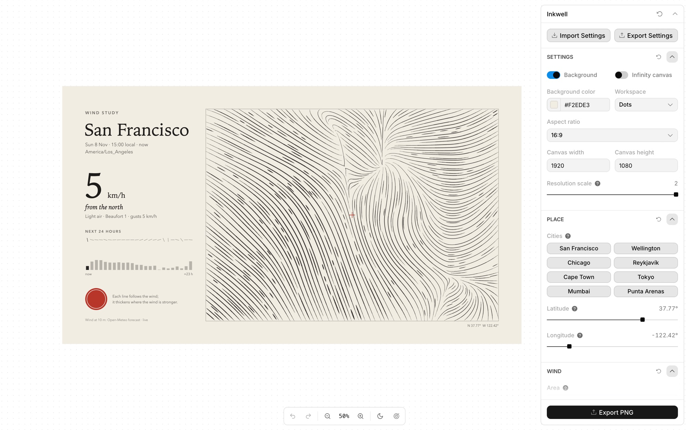

<div align="center">

<h1>Inkwell</h1>

<p><b>The wind, drawn in ink.</b></p>

<p><i>Brush lines follow the live wind around any city and thicken where it blows harder, beside its speed, direction and the next 24 hours.</i></p>

<h6>


</h6>

<a href="https://inkwell.parthchandak.info"><b>Live app</b></a> ·
<a href="#how-it-works"><b>How it works</b></a> ·
<a href="#run-it"><b>Run it</b></a>

<br><br>

<a href="https://inkwell.parthchandak.info"></a>

<sub>The default poster: San Francisco with the live forecast.</sub>

</div>

<br>

Inkwell draws the wind over a place as a field of brush lines on paper. Every line follows the
wind, tapers at both ends and thickens where the wind is stronger, so calm air reads as fine
hairlines and a gale as heavy strokes. The left column gives the place and local time, the wind
speed at the centre with the compass direction it comes from, its Beaufort force and gusts, and a
strip of the next 24 hours with a small downwind tick above each hour.

Pick one of eight cities (San Francisco, Wellington, Chicago, Reykjavík, Cape Town, Tokyo, Mumbai,
Punta Arenas) or drag Latitude and Longitude. Choose the Area (City, Region or Wide), step through
the forecast with Hours ahead, and style the Ink: colour, line spacing and brush width. The
background can be changed (dark ink turns paper-light on dark backgrounds) or left out, and the
poster exports as PNG or JPG at 2K, 4K or 8K.

## How it works

Inkwell asks the free [Open-Meteo forecast API](https://open-meteo.com/en/docs) for the 10 m wind on
a 7 × 5 grid of points around the centre in one request (24 hours of speed, direction and gusts),
and caches it per view. Wind vectors are interpolated between the points, and evenly spaced
streamlines are traced through them with an occupancy grid (in the style of Jobard and Lefer), then
drawn in ten width bands. If the API cannot be reached, a clearly labelled sample breeze is shown.

The poster is drawn with Canvas 2D in a Web Worker at the exact zoomed backing resolution, and the
same drawing function renders the exported image. The editor shell, panel, settings import/export,
saved workspace and image export come from [Toolcraft](https://github.com/pixel-point/toolcraft)
(Pixel Point, MIT).

## Run it

```bash
git clone https://github.com/parthchandak02/inkwell.git
cd inkwell
npm install
npm run dev              # local editor; needs Node 22+
npm test                 # unit tests plus Toolcraft's contract checks
npm run verify:delivery  # full functional acceptance in a real browser
```

The live version is a static build (`npm run build`, then `dist/`) on Cloudflare Pages.

<details>
<summary><b>Project layout</b></summary>

```
src/inkwell/wind-data.ts         Grid request, parsing, cache, offline sample
src/inkwell/inkwell-draw.ts      Wind sampling, streamlines and the whole poster
src/inkwell/InkwellCanvas.tsx    The live canvas: worker raster at the exact backing size
src/inkwell/inkwell-controls.ts  Place, Wind and Ink controls; city shortcuts
src/app/app-schema.ts            Toolcraft schema: sections, canvas, image export
src/app/app-acceptance-data.ts   What every control must visibly do (checked in a real browser)
e2e/product-inkwell-*.spec.ts    Browser acceptance tests, one file per area (API stubbed)
src/toolcraft/                   Vendored Toolcraft runtime (do not edit)
```

</details>

<br>

<div align="center">
<sub>Built with Toolcraft, React and Canvas 2D. Wind from Open-Meteo.</sub>
</div>
