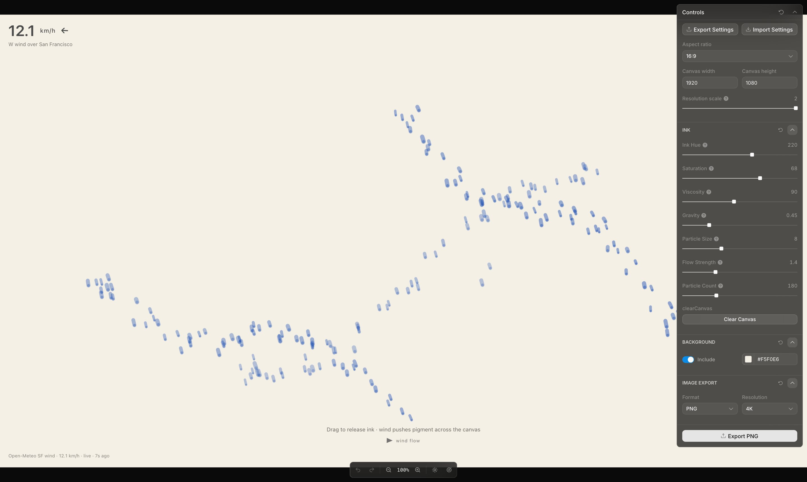

<div align="center">

<h1>Inkwell</h1>

<p><b>Drag ink onto paper. San Francisco's wind moves it.</b></p>

<p><i>A drawing toy whose drift isn't random: the pigment drifts with the wind blowing over the city right now.</i></p>

<h6>


</h6>

<a href="#how-it-works"><b>How it works</b></a> ·
<a href="#controls"><b>Controls</b></a> ·
<a href="#run-it"><b>Run it</b></a>

<br><br>



<sub>Local build with live wind data, 22 October 2026. The strokes were drawn by a scripted drag.</sub>

</div>

<br>

Every drag across the canvas sheds blue ink particles that leave short brush-like trails on a
cream rice-paper background, sink a little under gravity, and drift with the current wind over
San Francisco from the [Open-Meteo](https://open-meteo.com/) forecast API. A calm day lets ink
pool where you put it; a strong westerly carries it off the right edge. No API key is needed.

## How it works

| Input | Drives |
|---|---|
| `current_weather.windspeed` (km/h, 37.77° N 122.42° W) | Drift speed: 0 to 100 km/h maps to 0 to 30 px/s, scaled by Flow Strength |
| `current_weather.winddirection` | Drift direction. Meteorological convention, so a west wind pushes ink east |
| Your pointer | Pressing spawns 4 particles at the cursor; holding or dragging adds 2 more every frame, each with a small random impulse |
| Viscosity slider | Trail length and how slowly each trail fades |

The page polls Open-Meteo every 60 seconds. If the request fails it falls back to a 5 km/h west
wind and the footer stamp reads `fallback` instead of `live`. Particles fade out, leave the
canvas, or are dropped oldest-first once the particle cap is reached.

## Controls

- **Ink.** Hue (0 to 360), saturation, viscosity, gravity, particle size, flow strength and
  maximum particle count (50 to 500), plus Clear Canvas.
- **Background.** Toggle the rice-paper fill and pick its colour; turning it off exports ink on transparency.
- **Canvas.** Aspect ratio, output size and render scale, with zoom, undo and redo in the toolbar.
- **Export.** Save the current canvas as PNG or JPG at 2K, 4K or 8K. Settings themselves can be
  exported and imported as a file.

## Run it

```bash
git clone https://github.com/parthchandak02/inkwell.git
cd inkwell
npm install
npm run dev      # dev server on a free port
npm run build    # typecheck, then static site in dist/
npm test         # unit and integrity checks
```

The build is a static `dist/` folder. `inkwell.parthchandak.info` currently serves a different,
dark-themed wind-particle piece, not this build.

<details>
<summary><b>Project layout</b></summary>

```
src/app/ink-simulation.ts   Particle physics and canvas drawing
src/app/wind-data.ts        Open-Meteo fetch, fallback, wind-vector maths
src/app/app-schema.ts       Every control in the panel, declared for Toolcraft
src/app/inkwell-chrome.tsx  Wind readout and on-canvas captions
src/app/inkwell-export.ts   PNG/JPG export at 2K, 4K, 8K
src/toolcraft/              Toolcraft runtime and UI components (vendored)
e2e/                        Playwright browser and performance tests
brief.md                    The original creative brief and encoding contract
```

The app shell, panel and toolbar come from Pixel Point's Toolcraft starter. That code is covered
by [LICENSE.md](LICENSE.md) and [NOTICE.md](NOTICE.md); the ink simulation and wind code are this project's own.

</details>

<br>

<div align="center">
<sub>Built with React, Vite, Tailwind and Toolcraft. Wind data from Open-Meteo.</sub>
</div>
